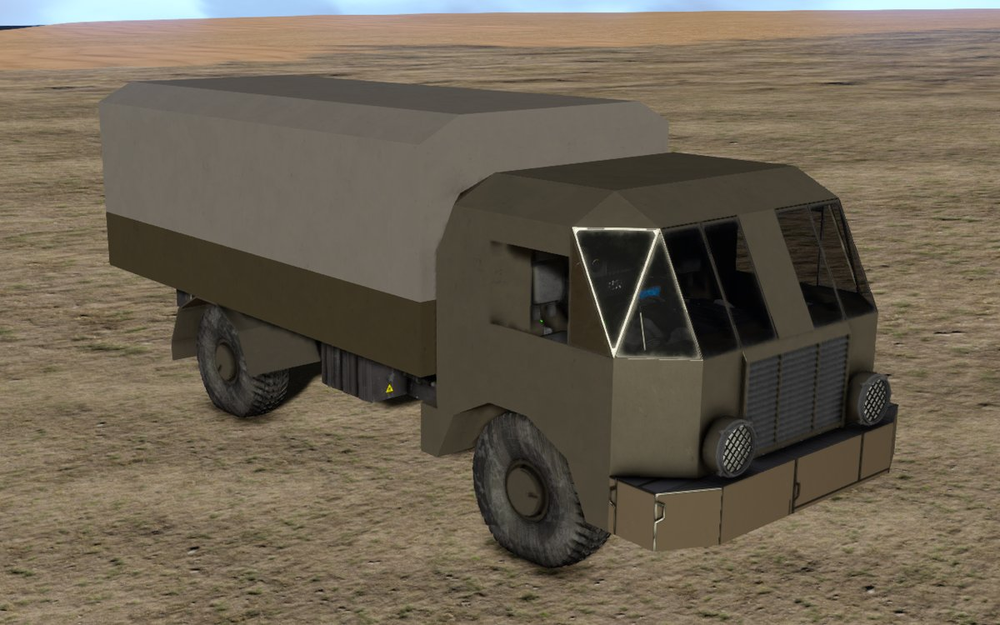
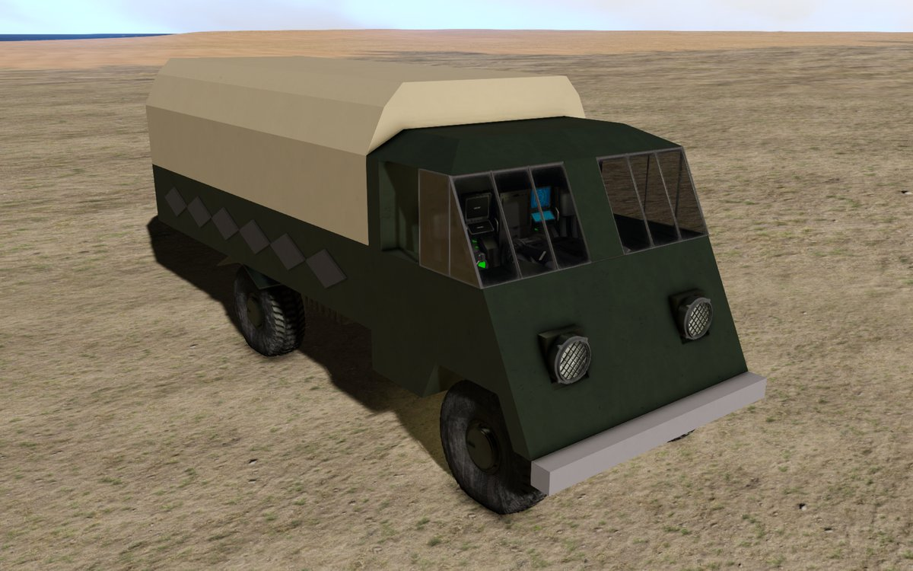
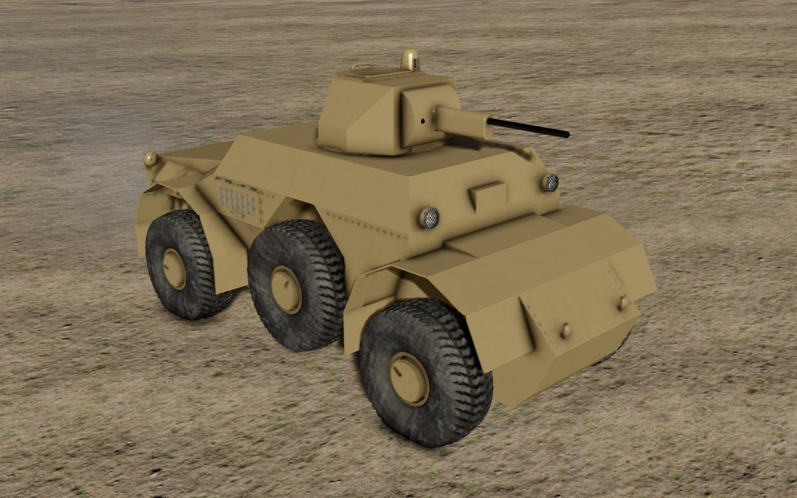
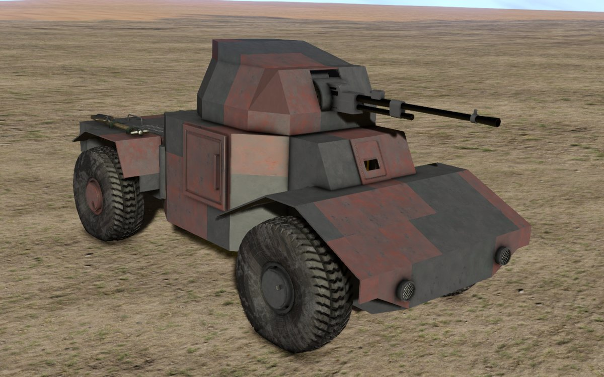

# Rosters

!!! abstract "Quick facts"
    - Every vehicle is a replica of a real Italian or French design of 1940 to 1943.
    - Prices below are **base prices**. Stores sell at 115 to 135% of base, adjusted by the site's supply
      ([Stores and Prices](../economy/stores.md)).
    - "From" is the War Level at which the vehicle starts appearing in garages, factories, and spawns. Depots currently
      sell their side's whole ground list.

## Ground

| Vehicle | Side | Class | Base price | From | Sold at |
|---|---|---|---|---|---|
| Fiat 626 | Gray | Utility truck (respawn) | 125,000 | 1 | Gray ports, Valencia, depots |
| Renault AHN | Green | Utility truck (respawn) | 125,000 | 1 | Green ports, Valencia, depots |
| AB41 | Gray | Armored car | 60,000 | 1 | Gray ports, Valencia, depots, factories |
| Panhard 178 | Green | Armored car | 40,000 | 1 | Green ports, Valencia, depots, factories |
| AB43 | Gray | Armored car | 2,775,000 | 2 | Factories |
| L6/40 | Gray | Light tank | 1,400,000 | 2 | Depots, factories |
| Renault R35 | Green | Light tank | 2,100,000 | 2 | Green ports, depots, factories |
| M13/40 | Gray | Medium tank | 5,500,000 | 3 | Depots, factories |
| Somua S35 | Green | Medium tank | 5,525,000 | 3 | Depots, factories |
| P26/40 | Gray | Heavy tank | 4,225,000 | 4 | Depots, factories |
| Char B1 | Green | Heavy tank | 4,225,000 | 4 | Depots, factories |

### War Level 1 ground vehicles

- 

    **Fiat 626**, Gray: utility and respawn truck.

- 

    **Renault AHN**, Green: utility and respawn truck.

- 

    **AB41**, Gray: armored car.

- 

    **Panhard 178**, Green: armored car.

## Air

| Plane | Side | Class | Base price | From | Sold at |
|---|---|---|---|---|---|
| Re.2000 | Gray | Fighter | 30,000 | 1 | Airfields, factories |
| Re.2001 | Gray | Fighter | 25,000 | 2 | Airfields, factories |
| MS.406 | Green | Fighter | 25,000 | 1 | Airfields, factories |
| D.520 | Green | Fighter | 25,000 | 2 | Airfields, factories |
| Ba.65 | Gray | Attacker | 1,400,000 | 2 | Airfields |
| FC.20 | Gray | Attacker | 5,475,000 | 3 | Airfields, factories |
| Potez 630 | Green | Attacker | 1,400,000 | 3 | Airfields, factories |
| SM.79 (bomber / torpedo) | Gray | Bomber | 4,100,000 / 4,125,000 | 3 | Airfields, factories |
| V-156-F (bomber / torpedo) | Green | Bomber | 4,075,000 | 3 | Airfields, factories |
| Ju 52 | Gray | Cargo | 700,000 | 1 | Gray ports, hangars, Valencia |
| F.222 | Green | Cargo | 150,000 | 1 | Green ports, hangars, Valencia |

NPC only (not sold): Ro.43 and Loire 130 floatplanes.

## Naval

| Ship | Side | Class | Base price | From | Sold at |
|---|---|---|---|---|---|
| Golo (Italian) | Gray | Utility / cargo | 18,500,000 | 1 | Gray ports, Valencia |
| Golo (French) | Green | Utility / cargo | 18,500,000 | 1 | Green ports, Valencia |
| Gabbiano | Gray | Corvette | 7,975,000 | 1 | Gray ports, Valencia |
| La Malouine | Green | Corvette | 11,025,000 | 1 | Green ports, Valencia |
| Francesco Crispi | Gray | Destroyer | 45,650,000 | 2 | Gray ports |
| Bougainville | Green | Aviso (destroyer class) | 47,075,000 | 2 | Green ports |
| Strasbourg | Green | Battleship | 187,775,000 | 5 | Green ports |

NPC only for now: Spica, Comandante Margottini, Le Triomphant, Trento, Émile Bertin, Algérie, Aquila, Béarn.
Coming: the Zara heavy cruiser and the battleship Littorio for Gray.
