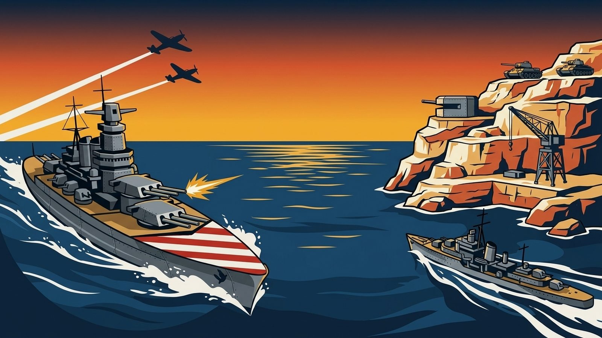

---
hide:
  - navigation
  - toc
---

# War in the Mediterranean

{ .witm-hero }

A WW2 scenario for Space Engineers, set around the Mediterranean in the early 1940s. Two sides, Gray
(Italy) and Green (France), fight over sea lanes, airfields, depots and coastlines on a
60 km planet shaped like the real Mediterranean. You pick a side, salvage, trade and capture your way up from a truck
to a warship, and the war around you escalates as everyone fights.

[Getting Started](start/getting-started.md){ .md-button .md-button--primary }
[Steam Workshop](https://steamcommunity.com/sharedfiles/filedetails/?id=3793633400){ .md-button }
[Mod List](reference/mod-list.md){ .md-button }

!!! info "Which version this wiki describes"
    Checked against the mod's development build of **2026-11-21**, which is newer than the last Workshop update
    (1.2.2, 2026-11-08). Items marked *next update* on [What's New](start/whats-new.md) are not on the Workshop yet.

## Pages

-   **Start here**

    ---

    Your first hour, what changed recently, chat commands, and notes for the server.

    [Getting Started](start/getting-started.md) · [What's New](start/whats-new.md) ·
    [Chat Commands](start/chat-commands.md) · [Playing on the Server](start/playing-on-the-server.md)

-   **The world**

    ---

    The planet, the two sides, how territory grows and how the War Level rises.

    [The Map](world/map.md) · [Factions and Sides](world/factions.md) ·
    [Territory and War Level](world/territory-war-level.md) · [War News and Supply](world/war-news-supply.md)

-   **Encounters**

    ---

    What the NPCs build, fly, sail and drive, and how they behave.

    [Installations](encounters/installations.md) · [At Sea](encounters/sea.md) ·
    [In the Air](encounters/air.md) · [On the Ground](encounters/ground.md)

-   **Ships, vehicles and combat**

    ---

    Ship Cores, block limits, weapons, capturing vehicles, and the full rosters.

    [Ship Cores](combat/ship-cores.md) · [Weapons](combat/weapons.md) ·
    [Capturing Vehicles](combat/capturing.md) · [Rosters](combat/rosters.md)

-   **Economy and building**

    ---

    Stores and prices, salvage and the three special components, and building rules.

    [Stores and Prices](economy/stores.md) · [Salvage](economy/salvage.md) · [Building](economy/building.md)

-   **Reference**

    ---

    Mods, world settings, terms, and the people whose work the scenario is built on.

    [Mod List](reference/mod-list.md) · [World Settings](reference/world-settings.md) ·
    [Glossary](reference/glossary.md) · [Credits](reference/credits.md)

Found a mistake on this wiki, or something in game that doesn't match it? Tell the mod author in the comments on
the Workshop page.
